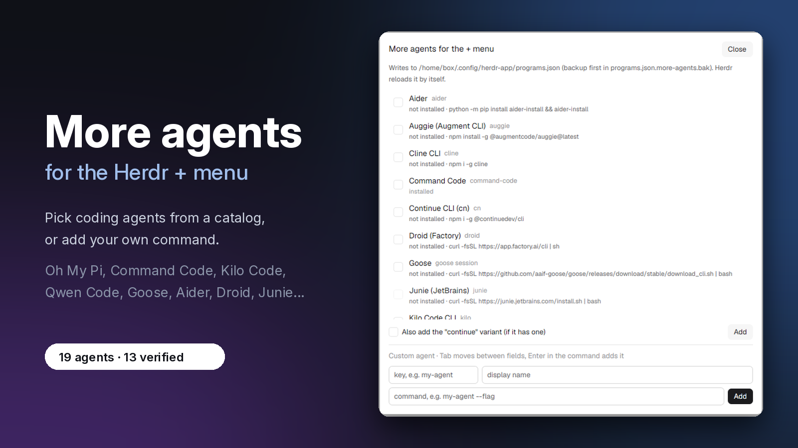

[English: README.md](README.md)

# Más agentes: un mod de Herdr App

Añade al menú + de Herdr agentes de programación que no vienen listos para arrancar: elígelos de un catálogo o añade tu propio comando.



## Instalar

`npx github:Izzy2024/More-Agent-Mod` (un comando; necesita `node` 22+ y que el repositorio sea público en GitHub), o clona:

```sh
git clone https://github.com/Izzy2024/More-Agent-Mod.git && cd More-Agent-Mod && node scripts/install.mjs
```

`--with-key` asigna además Alt+Mayús+A; `--dry-run` enseña lo que cambiaría; `--uninstall` quita el mod (y esa tecla, si sigue siendo la que escribió `--with-key`).

## Ábrelo

`herdr-app do mod.open --name more-agents`, o pulsa Alt+Mayús+A después de `--with-key`.

## Lo que puedes hacer

- Elige agentes del catálogo y pulsa **Añadir**; el diálogo enseña cuáles están instalados y cuáles no.
- Pulsa **Instalar** en un agente que falta: pregunta antes, ejecuta el comando de instalación en una pestaña nueva y añade el agente cuando el comando aparece.
- Si un agente está instalado en una carpeta que Herdr no ve, usa **Usar ruta completa** para que su entrada apunte al archivo real (pregunta antes).
- Añade cualquier otro agente de línea de comandos con **Añadir tu propio agente...**: una clave, un nombre y un comando.
- Pulsa **Eliminar** (o **Eliminar continue**) para quitar solo lo que añadió este mod. El menú + se actualiza solo.
- Cambia el diálogo entre inglés y español con EN / ES en la cabecera.
- Si quieres, dale a un agente un bridge de estado para el panel Agentes; el diálogo pregunta antes de instalarlo o quitarlo.

## Conviene saber

**Puede que un agente añadido no salga en el menú +.** Herdr enseña todos los agentes instalados, es decir, aquellos cuyo `run[0]` está en el PATH. De los que no están instalados solo enseña los dos primeros de su orden interno, que siempre son Claude Code y Codex. Ningún campo de `programs.json` cambia esto. El diálogo marca cada fila como `instalado`, `no instalado`, `no se pudo comprobar` o `instalado, pero Herdr no lo ve`, y la caché de Herdr puede tardar hasta 60 s.

**Lo que escribe y guarda el mod.**

- `~/.config/herdr-app/programs.json`: fusiona sus entradas y nunca reemplaza una tuya que ya tenga `run`.
- Tras un guardado correcto, el archivo anterior va a `programs.json.more-agents.bak`; el primer guardado guarda además el archivo tal como estaba antes del mod en `programs.json.more-agents.orig.bak`.
- Las copias son un extra: si fallan, se avisa sin bloquear el guardado.

**Lo que nunca cambia.** Tus entradas con `run` y los demás campos que ya están en `programs.json`; `keys.json` (salvo que pases `--with-key`); los archivos de hooks de otros agentes (salvo que instales un bridge).

## Compatibilidad

Probado en Herdr 0.1.13 en macOS (comprobación estática y diálogo real); antes, en Herdr 0.1.10 en Linux. Windows no está probado. Necesita Herdr App 0.1.8 o posterior y `node` 22+ para el instalador y los bridges de estado.

## Contribuir / Desarrollo

Mira [CONTRIBUTING.es.md](CONTRIBUTING.es.md) para añadir un agente por pull request, y [docs/ARCHITECTURE.es.md](docs/ARCHITECTURE.es.md) para saber cómo funciona el mod por dentro.

```sh
node scripts/validate-catalog.mjs   # esquema del catálogo
node scripts/smoke-test.mjs         # lógica del diálogo, sin UI
node scripts/check-links.mjs        # URL de docs/source y frescura (--offline: solo frescura)
```
