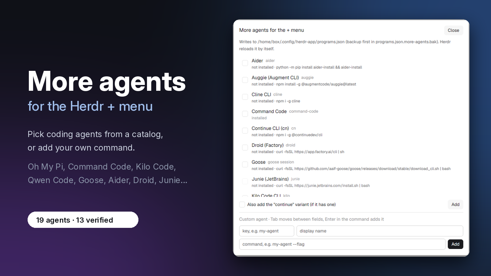

[Español: README.es.md](README.es.md)

# More agents: a Herdr App mod

Adds coding agents that Herdr doesn't ship ready to start to its + menu: pick them from a catalog, or add your own command.



## Install

`npx github:Izzy2024/More-Agent-Mod` (one command; needs `node` 22+), or clone:

```sh
git clone https://github.com/Izzy2024/More-Agent-Mod.git && cd More-Agent-Mod && node scripts/install.mjs
```

`--with-key` also binds Alt+Shift+A; `--dry-run` shows what would change; `--uninstall` removes the mod (and that key binding if it is still the one `--with-key` wrote).

## Open it

`herdr-app do mod.open --name more-agents`, or press Alt+Shift+A after `--with-key`.

## What you can do

- Pick agents from the catalog and press **Add**; the dialog shows which ones are installed and which are not.
- Press **Install** on a missing agent: it asks first, runs the install command in a new tab, and adds the agent when the command appears.
- If an agent is installed in a folder Herdr cannot see, use **Use full path** to point its entry at the real file (it asks first).
- Add any other command-line agent with **Add your own agent...**: a key, a name and a command.
- Press **Remove** (or **Remove continue**) to take out only what this mod added. The + menu updates by itself.
- Switch the dialog between English and Spanish with EN / ES in the header.
- Optionally, give an agent a status bridge for the Agents panel; the dialog asks before installing or removing one.

## Good to know

**An added agent may not show in the + menu.** Herdr shows every installed agent, meaning one whose `run[0]` is on the PATH. Of the agents that are not installed it shows only the first two in its internal order, which are always Claude Code and Codex. No field in `programs.json` changes this. The dialog marks each row `installed`, `not installed`, `could not check` or `installed, but Herdr can't see it`, and Herdr's cache can take up to 60 s.

**What the mod writes and backs up.**

- `~/.config/herdr-app/programs.json`: it merges its entries and never replaces one of yours that already has `run`.
- After a successful save, the previous file goes to `programs.json.more-agents.bak`; the first save also keeps the pre-mod file as `programs.json.more-agents.orig.bak`.
- Backups are best-effort: a failure is reported without blocking the save.

**What it never changes.** Your entries with `run` and the other fields already in `programs.json`; `keys.json` (unless you pass `--with-key`); other agents' hook files (unless you install a bridge).

## Compatibility

Tested on Herdr 0.1.13 on macOS (static check and live dialog); earlier, on Herdr 0.1.10 on Linux. Windows is not tested. Needs Herdr App 0.1.8 or newer and `node` 22+ for the installer and the status bridges.

## Contributing / Development

See [CONTRIBUTING.md](CONTRIBUTING.md) to add an agent by pull request, and [docs/ARCHITECTURE.md](docs/ARCHITECTURE.md) for how the mod works inside.

```sh
node scripts/validate-catalog.mjs   # catalog schema
node scripts/smoke-test.mjs         # dialog logic, no UI
node scripts/check-links.mjs        # docs/source URLs and freshness (--offline: freshness only)
```
