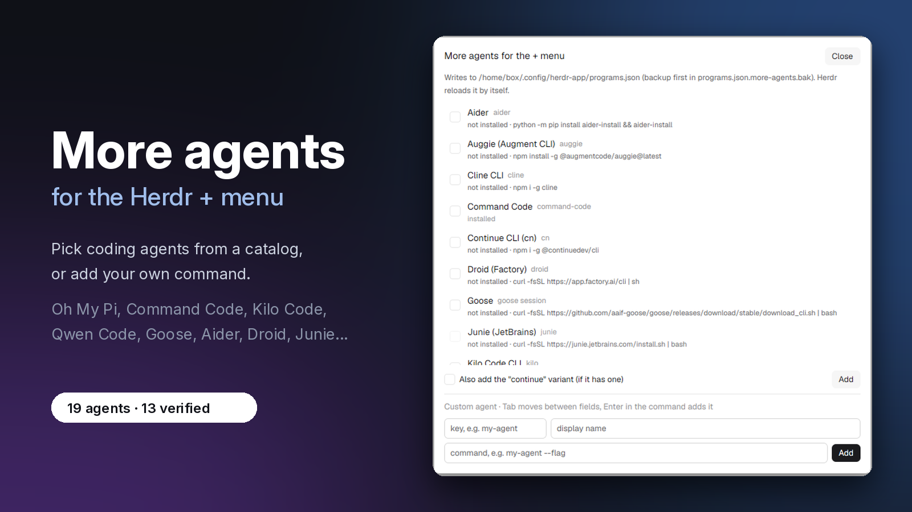

# More agents

Its catalog lists 25 coding agents: 19 you can add, such as Oh My Pi (`omp`), Command Code, Kilo Code, Qwen Code, Goose, Aider, Droid, Auggie, Junie, Mistral Vibe, Kiro CLI and Pi, plus 6 that already ship with Herdr. You pick them from the catalog, or add any other command-line agent by name and command.



```sh
npx github:Izzy2024/More-Agent-Mod
```

Or clone the repo and run `node scripts/install.mjs`; `--with-key` also binds Alt+Shift+A. Open it with `herdr-app do mod.open --name more-agents`.

## What you see

A dialog titled "More agents for the + menu". It opens on a search box; the list is grouped into Ready to add, Needs install, Already in your + menu and Ships with Herdr (collapsed). One row per agent: name, the command it runs, whether it is installed, and how to install it when it is missing. Rows you can add have a checkbox. Rows for agents Herdr already ships say so and are greyed. Below the list:

- a "continue" checkbox;
- an Add button with the number of agents you picked;
- a form for your own agent: key, name, command;
- a Bridge button for agents that need a status adapter.

## How it behaves

**Adding.** Tick agents and press Add. Each one becomes an entry in `~/.config/herdr-app/programs.json`, and everything else in that file is kept.
- With "continue" ticked, a second entry starts the agent on its last session. This happens only where the agent documents a flag for it.
- An entry you already have with a command is never replaced.
- After a successful write, the previous version is saved to `programs.json.more-agents.bak`, and the first write keeps the pre-mod file as `programs.json.more-agents.orig.bak` (never replaced). Both are best-effort: a failure is reported without blocking the write.
- The write only goes through if nobody changed the file since it was read; a stale write is retried once from the new snapshot, and a second conflict writes nothing.
- A missing agent has an Install button. It asks first, runs the documented command in a new tab, and adds the agent when the command appears. If a tool it needs is missing, the button says which one instead.
- An agent installed where Herdr cannot see it gets "Use full path", which points the entry at the real file after you confirm.
- A custom agent whose command can't be found on this computer asks first ("… will not show in the + menu until it is installed. Add anyway?"), so a typo cannot slip in silently.
- A broken programs.json is never written; the dialog names the failure (read, JSON, shape) and offers Reload instead of asking you to reopen it.
- Rows say `installed`, `not installed`, `installed, but Herdr can't see it` or `could not check`, using your login shell (the same one the + menu starts programs with). Saves show "Saving…" with the buttons disabled, and the toast is a count ("Added 2; 1 needs install") while the dialog keeps the hints.
- The header switches the dialog between English and Spanish.

Herdr reloads the table live, so new agents show in the + menu at once.

**Removing.** Remove deletes only the entries this mod added. The base entry and its `-continue` variant are separate actions (`Remove` / `Remove continue`, and `Add continue` next to an existing base), so you can keep one without the other.

**Contributing.** The catalog is plain data in `mods/more-agents/catalog.js`, so new agents come in by pull request.

## Built from

- `mods/more-agents/main.js`
- `catalog.js` (data only), `copy.js` (English/Spanish), `repair.js`, `path-probe.js`, `path-scan.js`, `install-assist.js`, `bridge-install.js`
- `mod.json` (place none, dialog overlay)

It uses `readTextFile`, `writeTextFile`, `exec` (a login shell, or `where` on Windows), `knownAgents`, `shared` and `notify`.

## Watch out

- Status (working, blocked, done) only comes from agents that report OSC 7501. An agent that doesn't report it stays a plain terminal with its icon.
- Trae Agent lives in a uv virtualenv, so `trae-cli` has to be installed where your login shell can find it.
- Kiro's curl installer is documented for macOS; on Linux or Windows follow the docs.
- Forge and Codebuff have no documented continue flag, so they get no continue variant.
- Most catalog agents use Herdr's generic agent icon.
- Needs Herdr App 0.1.8 or newer and `node` 22+ for the installer and the status bridges.

## Done when

- After Add, the + menu lists the agents you picked, and each one starts in a new tab.
- `herdr-app status` shows no programs.json error.
- Remove takes the agents out again.
